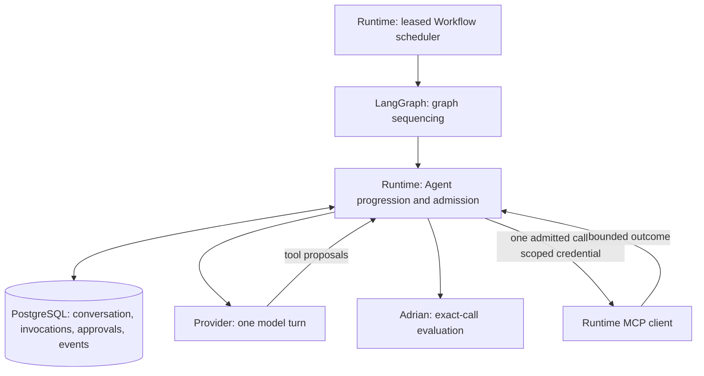
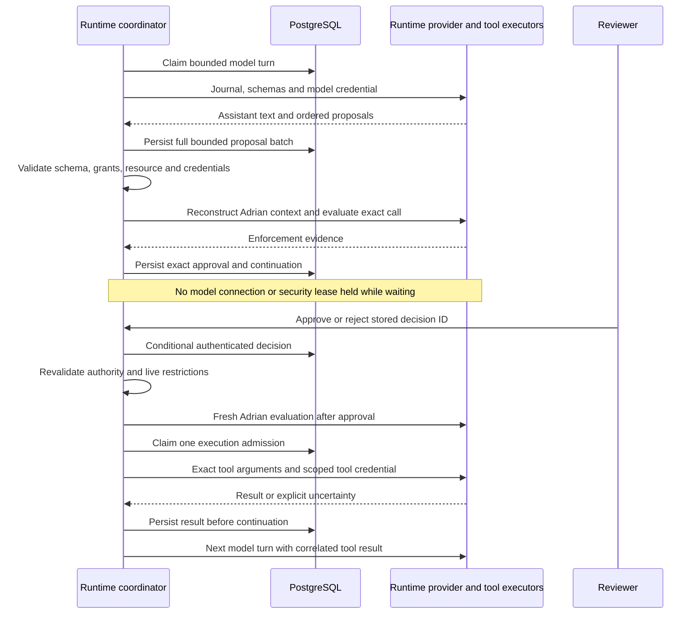

# Agent tools, approval and recovery

ADT owns tool authority. OpenAI, Anthropic and tool-capable Ollama models propose calls; only ADT admits and executes them. Tool calls are internal Agent events, not authored Workflow blocks.

## Responsibilities



- Git owns Agents, Workflows, tool definitions, frozen catalogues and declarative non-secret policies. Protected PostgreSQL attestations independently establish which exact policies have administrator authority.
- PostgreSQL stores versioned conversations, call identities, budgets, decisions, execution results and reconciliation evidence.
- Runtime persists execution state in PostgreSQL. Model envelopes contain schemas and model credentials, never MCP credentials or tool execution authority.
- The existing explicit `approval@1` block remains a separate graph-level gate.

## Authoring

- Enable each tool explicitly in the Agent editor. Existing Agents with no grants remain tool-free.
- Agent defaults include risk-based or mandatory approval and execution limits.
- Agent block version 4 adds `toolRestrictions`. Absent `allowlist` inherits; `[]` disables every tool. Entries use `artifact_search` or `mcp:<serverId>:<remoteName>`.
- `requireApproval` strengthens approval for selected inherited grants. `limits` takes the minimum of Agent and block settings.
- The editor previews effective grants. Server-side validation rejects attempted expansion. Layout remains presentation-only.

## Trusted policies

Configure comma-separated GitHub logins in Runtime `ADT_TOOL_POLICY_ADMINS`, `ADT_TOOL_APPROVERS` and `ADT_TOOL_OPERATORS`. Keep the Worker policy administrator list consistent for authoring checks. All three roles default to nobody and remain independent. Current repository access is required in addition to a role. A per-tool reviewer list narrows the explicitly delegated approvers; it never grants approval authority itself. The inspector exposes approval/rejection controls only to currently eligible users. Both decisions require current delegation, frozen reviewer eligibility and an active, unexpired pending invocation. Approval additionally requires applicable live reviewer restrictions and verified execution authority. When a live policy is changed, revoked, missing or unverified, an eligible frozen reviewer can still reject the call; the persisted rejection returns a correlated denial to the model without resolving credentials or authorizing execution. Expiry, cancellation and duplicate-decision safeguards still apply. Existing operator reconciliation and explicit Workflow `approval@1` remain separate permission contracts.

For a personal deployment, explicitly put your GitHub login in `ADT_TOOL_APPROVERS`. Also configure it in `ADT_TOOL_POLICY_ADMINS` to classify tools or authorize policies, and in `ADT_TOOL_OPERATORS` to reconcile uncertain execution. None of these lists implies another role.

Policy administrators edit `toolPolicies` in the MCP editor after discovering the relevant tool identities. Keys are exact remote tool names. Ordinary users may make metadata updates that preserve effective trusted policy. Adding, changing, removing or indirectly invalidating a policy requires administrator authority before Git or credential mutation. A target/authentication change or bearer replacement with existing policies is rejected for non-admins. Administrators must explicitly authorize the displayed rules for the new identity; otherwise the old rules are cleared. Remote discovery never assigns trusted classifications, and cannot silently replace the schema of a policy-bearing tool; an administrator must clear/review its policy first.

Git policy text is not proof of administrator authorization. Immutable PostgreSQL attestations bind the repository ID, MCP server, exact policy digests, tool names and input schemas, endpoint, authentication mode and credential generation. Every bearer identity also binds the credential reference digest, including servers without explicit policies. Credential replacement through the application invalidates earlier frozen authority and approvals even if the binding generation is unchanged. Policy-free rotation remains available to ordinary authorized users; rotation with existing policies still requires administrator review. A newly frozen invocation uses the replacement credential under its applicable approval policy and mandatory security checks. Credential lookup checks the verified secret reference so concurrent rotation cannot substitute a replacement token. No secret values enter an attestation or frozen run.

Both run freezing and every live authority resolution require a matching, ready attestation. Historical snapshots without a proof ID, or bearer proofs without a credential identity digest, remain readable but cannot authorize new execution; no proof is inferred or backfilled from Git. New frozen snapshots retain the original proof ID and maximum policy; current verified policies add restrictions. Execution admission and affirmative human decisions pin the verified PostgreSQL head revision. Direct Git edits to classifications, automatic exceptions, denials, reviewers, schema or target therefore cannot grant authority: missing, stale, conflicting or mismatched proof fails closed. Git commit authorship and repository write permission are never administrator proof. Name/description edits and unclassified catalogue changes may preserve a valid proof, but do not create trusted classifications or global roles.

A save marks the PostgreSQL authority head unavailable before Git/credential writes. Publication verifies the exact saved definition and binding; compensation restores an earlier head only after checking coherent old state. An interrupted or ambiguous save remains unavailable, without an automatic lease takeover. A policy administrator must inspect the Git definition and credential binding, repair inconsistent state using trusted operator procedures if needed, then explicitly review and save the rules to reauthorize. Deleted servers retain a blocked authority record so recreation cannot silently discard an old denial. PostgreSQL and Runtime configuration are trusted control-plane state and must be backed up/protected independently of the artifact Git repository.

Example policy:

```json
{
  "update_issue": {
    "classification": "mutating",
    "minimum": "automatic",
    "automaticWhen": [{"path": ["repository"], "equals": "acme/docs"}],
    "resource": {"path": ["repository"], "allowed": ["acme/docs"]},
    "rules": [{"when": [{"path": ["close"], "equals": true}], "decision": "approval"}],
    "reviewers": ["release-reviewer"],
    "expirySeconds": 3600
  }
}
```

- Trusted `read_only` defaults to automatic execution after mandatory security checks.
- Unknown, mutating and sensitive tools default to approval. Names, descriptions and MCP annotations do not establish read-only status.
- Explicit automatic execution for mutations requires an administrator-authorized policy. Whenever `automaticWhen` is supplied, its conditions must match for automatic execution, including trusted read-only defaults; a mismatch requires approval. Another mandatory approval or denial still wins.
- `minimum: approval` or `deny` strengthens the default. Conditional rules can require approval or deny; they cannot grant authority.
- Resource restrictions require an exact allowed value at the configured argument path. Tools needing finer resource enforcement must not receive broader automatic policies.
- Frozen and current tool policies both apply. Agent and block requirements strengthen them. Any denial wins, then any approval requirement wins.
- Reviewers must satisfy the intersection of applicable reviewer lists. A changed live reviewer restriction invalidates an earlier reviewer who no longer qualifies.
- Approval applies to one immutable invocation. Repeating an equivalent rejected proposal creates another approval requirement within the same durable proposal budget.

## Model and tool sequence



Rejection skips execution and appends a structured denial. Calls in a batch execute serially in provider order. Later siblings wait for an earlier approval. All results are correlated before another model turn. Parallel Workflow branches remain supported; separate Agents can wait independently.

## Journal and recovery

```mermaid
stateDiagram-v2
    ready --> model_running
    model_running --> tools: Persist proposals
    model_running --> completed: Persist final text
    model_running --> failed: Invalid or uncertain model outcome
    tools --> waiting: Exact human approval
    waiting --> tools: Decision; approval revalidates security
    tools --> reconciliation: Admitted tool outcome unknown
    reconciliation --> tools: Verified result or confirmed non-execution
    reconciliation --> failed: Explicit termination
    tools --> ready: Persist all correlated results
```



- Model turns, proposals, admissions, aggregate result bytes, active time and reported token usage are durably bounded. Approval and reconciliation waits do not consume Agent active time.
- Provider token reporting is accounted when available. Input billing can exceed a remaining token allowance before usage is reported; further work then stops. This is not an exact monetary spending guarantee.
- A model request whose outcome is uncertain is not replayed automatically. Failed journaled Agent activations cannot use generic step retry, which could repeat completed tools or reset budgets. Inspect recorded outcomes and explicitly launch a new run if a new execution is intended.
- Tool admission identities and conditional transitions prevent duplicate admission. A timer never reassigns an admitted call.
- Each admission persists an absolute 30-second dispatch/execution deadline. Runtime bounds DNS, initialization, redirects, requests and result waiting by that deadline, preserves SDK cancellation, and destroys active sockets during cleanup. Existing individual MCP request timeouts remain 10 seconds. After the deadline plus 15 seconds for transport/persistence, recovery may mark the admission unknown; elapsed time never proves the remote side effect stopped.
- An unknown admission still accepts its matching late result until an authoritative operator decision wins. Result, accounting and audit writes are atomic. Operator decisions bind both invocation and admission IDs. Unresolved decisions retain that admission; confirmed non-execution fences it before another admission is possible. Stale successes and failures cannot settle the replacement.
- `toolResultBytes` is one aggregate budget for the entire activation, not a per-result allowance. PostgreSQL counts UTF-8 bytes of serialized ADT result envelopes, including denials, definite failures and operator-supplied results, once per authoritative outcome across all model turns and Runtime replacements. If a returned result exceeds the remaining allowance, record its outcome and byte count, omit its payload, and fail the activation. Do not invent an unknown side effect or send a fabricated result to the model. The observed byte count may exceed the allowance on that final result; further execution and continuation stop.
- Missing tool results, transport uncertainty and failures persisting a returned result require operator reconciliation. No success or failure is invented for the model.
- Recorded results are reused. Runtime replacement never requires completed tools to run again.
- PostgreSQL decisions are authoritative. Runtime rechecks paused runs and also wakes them after a recorded decision.
- Cancellation prevents new admissions. Evidence of admitted external work remains visible; cancellation does not prove that external work stopped.

## Operator reconciliation

Use the run inspector's **Agent tool activity** panel. Only `ADT_TOOL_OPERATORS` may reconcile an unknown invocation.

1. Inspect its exact invocation/admission IDs, target, arguments and audit history.
2. Investigate the target system's audit or idempotency records.
3. Choose confirmed success with a verified result, confirmed non-execution, still unresolved, or terminate without asserting an outcome.
4. Record supporting evidence or an explicit basis. Decisions are immutable, audited and idempotent by decision ID.

Before confirming non-execution, ensure the previous executor cannot dispatch later, and verify the exact action did not occur. ADT rejects non-execution reconciliation until its dispatch deadline has expired; that expiry alone does not establish non-execution. Re-admission rechecks policy, credentials, approval expiry and execution budgets. Never infer non-execution from a timeout. Generic MCP IDs provide no exactly-once side-effect guarantee. If a late result won first, refresh the inspector: the stale reconciliation is rejected. Retrying the same decision ID and content is idempotent; changing the admission, decision or evidence requires a new decision ID.

## Provider and schema limits

- Journaled OpenAI Agents use Chat Completions through the pinned Agents SDK public model API. Ordinary tool-free OpenAI Agents without journaled features and direct OpenAI Responses connections use Responses. GPT-6 Luna requires an explicit reasoning effort of **none** when Chat Completions offers functions. GPT-5 pro requires Responses. See the [GPT-6 Luna model reference](https://developers.openai.com/api/docs/models/gpt-6-luna) and [GPT-5 pro model reference](https://developers.openai.com/api/docs/models/gpt-5-pro).
- Model discovery checks availability. When model support is unknown, ADT submits the configured operation once. A provider can reject the API, tool proposals or requested settings. A text-only reply on a tool-enabled run offers no evidence about tool support.
- Anthropic uses native Messages client tools, `tool_use_id` correlations and ordered user `tool_result` blocks. The path supports text and client tool calls.
- Ollama checks `/api/show` before offering tools. A capabilities list that omits `tools` blocks inference. An omitted capabilities field or unavailable metadata route leaves tool support unknown and the chat request can proceed within the same deadline. Its endpoint must match the operator allowlist. ADT generates identities from turn and position and preserves result order, including repeated tool names.
- Hosted provider tools, SDK handoffs, images, embeddings, arbitrary provider metadata and private reasoning persistence are outside this contract.
- Argument validation uses a bounded JSON Schema subset with type, object properties/required/additionalProperties, arrays/items/uniqueness, size/numeric bounds, enum/const, and logical composition. Regex patterns, references, formats, conditionals, dependencies and unknown assertions fail closed. Descriptive annotations do not change validation. Arguments are never coerced or defaulted.
- Schema, argument, result, conversation and batch size limits are enforced independently. Oversized conversations fail rather than being silently summarised.
- Adrian Block enforcement is required for configured profiles. Alert remains diagnostic-only; Adrian Human Review is unsupported. ADT approval is separate. A fresh invocation-local Adrian context uses the frozen journal and a unique security session; unsupported or missing enforcement fails closed.

## Provider validation evidence and live smoke procedure

Coverage below describes this PR, not a certification of every model or endpoint. No live OpenAI/Anthropic credentials, Ollama endpoint, or deployed ADT Runtime endpoint were configured in the review environment; live model inference was **not run** for any provider.

| Provider | Executed automated coverage | Real model inference |
| --- | --- | --- |
| OpenAI | Pinned Agents SDK public model API with fixture Chat Completions responses; tool schemas, proposals, correlated results/denials, continuation and malformed-response checks; signed Runtime/D1/MCP approval-resume integration | Not run |
| Anthropic | Native Messages request/response fixtures; tool-use IDs, result/denial ordering, multi-turn continuation and invalid identities; signed Runtime/D1/MCP approval-resume integration | Not run |
| Ollama | Fixture `/api/show` capability discovery and `/api/chat`; allowlist and unverified-model refusal, generated IDs, repeated-name correlation, result/denial continuation; signed Runtime/D1/MCP approval-resume integration | Not run |

The security tests exercise real Adrian SDK/protobuf WebSocket handling against a controlled backend. Cross-provider integration also reconstructs fresh Adrian context using a controlled verdict service. Neither test claims validation of a production Adrian deployment or of a model's willingness to call a tool. Concurrency/recovery tests use real D1 emulation and controlled executors. The container smoke tests health/readiness and packaging, without provider inference.

Run the following against a non-production deployment for **each** provider/model/endpoint combination before commissioning it:

1. Complete the [PostgreSQL cutover](runtime-postgresql.md). Configure your GitHub login as policy administrator and operator; give the reviewer repository access and explicit `ADT_TOOL_APPROVERS` delegation. Store provider credentials through Connections, never in prompts or Git. Record source/runtime revisions and the exact provider/model/endpoint identity.
2. Register an operator-controlled HTTPS MCP server with an independent invocation audit. Supply a client tool named `read_probe` with schema `{"type":"object","properties":{"nonce":{"type":"string","minLength":1,"maxLength":64}},"required":["nonce"],"additionalProperties":false}`. Have it record each call and return `probe:<nonce>`. Use harmless test data and a fresh nonce per run. Discover and freeze the catalogue, then explicitly grant only this tool to the Agent.
3. Select `openai-agents` with an account-accessible supported Chat Completions model (for example `gpt-4.1` if available); select an available Claude Messages model for `anthropic-messages`. For `ollama-chat`, configure the endpoint/authentication and exact `ADT_RUNTIME_OLLAMA_ALLOWED_BASE_URLS` entry, and select an installed model whose `/api/show` reports `tools`. Run connection and execution-path checks from the application. These checks alone do not prove tool calling.
4. As policy administrator, classify `read_probe` as trusted `read_only`. Set the Agent prompt to: “Call the granted read_probe tool exactly once with nonce <fresh nonce>. After receiving its result, reply with the exact returned marker. Do not infer or invent the marker.” Launch a one-Agent Workflow. Require a journaled native model proposal, one MCP audit entry, a correlated result and final text containing that marker. A plausible final answer without a recorded tool call fails this smoke test.
5. Require ADT approval for the tool and use another nonce. While the inspector is waiting, verify zero MCP calls and restart/replace Runtime. Approve the exact call. Require the same activation/provider-call identity, one external call and a final result. Repeat with rejection; require zero external calls and a persisted correlated denial accepted by the next real model request. The model may finish or propose again; any repeated proposal must require a fresh approval.
6. Ask for two serial probes with different nonces, and repeat once with the same tool name in two proposals if the real model emits a batch. Verify provider-order results, no later sibling execution while an earlier approval is unresolved, and complete result correlation before the next model turn. Record “not observed” for a model that does not emit a batch; fixture coverage does not turn that case into live evidence.
7. Attach the actual Adrian Block profile. Repeat the approved flow with a known allowed policy, then with a known blocking policy. Require fresh enforcement after the wait, and zero MCP effects for denied/unavailable enforcement. Record the deployed Adrian version and policy identity without recording credentials.
8. To check recovery, configure the probe to record the call but withhold its response. Require unknown/reconciliation, no new model turn and no automatic retry. Check the independent server audit before recording verified success. Separately test confirmed non-execution only after stopping the prior executor and proving no call occurred. Verify the inspector rejects a stale admission decision and that late callbacks do not replace the winning result.
9. For Ollama, also select an installed model without advertised `tools`; require actionable refusal before `/api/chat`. For all providers, record request/run IDs, native call IDs (or generated Ollama identities), approval/reconciliation IDs, external call counts, exact model/server versions, timestamp, outcome and any unobserved cases. Keep secrets and private reasoning out of the evidence.

A passing result applies only to the recorded model/account/server configuration. Hosted tools, thinking blocks, images, arbitrary provider metadata and unsupported schema assertions remain outside this path.

## Migration and cutover

Follow the [PostgreSQL cutover guide](runtime-postgresql.md) to drain old runs, back up D1 and reauthorize MCP definitions. The new database starts with empty approval and tool journals. Resolve ambiguous external effects before resuming work.
