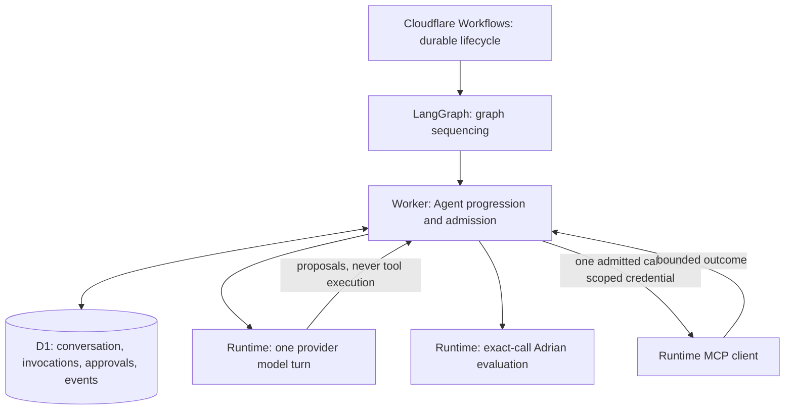
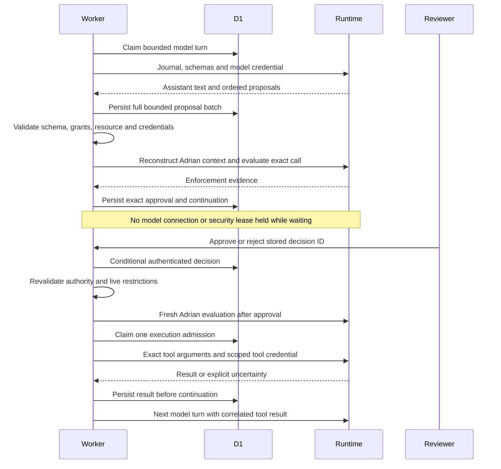

# Agent tools, approval and recovery

ADT owns tool authority. OpenAI, Anthropic and tool-capable Ollama models propose calls; only ADT admits and executes them. Tool calls are internal Agent events, not authored Workflow blocks.

## Responsibilities



- Git owns Agents, Workflows, tool definitions, frozen catalogues and non-secret policies.
- D1 owns versioned conversations, call identities, budgets, decisions, execution results and reconciliation evidence.
- Runtime has no durable execution state. Model envelopes contain schemas and model credentials, never MCP credentials or tool execution authority.
- The existing explicit `approval@1` block remains a separate graph-level gate.

## Authoring

- Enable each tool explicitly in the Agent editor. Existing Agents with no grants remain tool-free.
- Agent defaults include risk-based or mandatory approval and execution limits.
- Agent block version 4 adds `toolRestrictions`. Absent `allowlist` inherits; `[]` disables every tool. Entries use `artifact_search` or `mcp:<serverId>:<remoteName>`.
- `requireApproval` strengthens approval for selected inherited grants. `limits` takes the minimum of Agent and block settings.
- The editor previews effective grants. Server-side validation rejects attempted expansion. Layout remains presentation-only.

## Trusted policies

Configure comma-separated GitHub logins in Worker `ADT_TOOL_POLICY_ADMINS` and `ADT_TOOL_OPERATORS`. Both roles default to nobody. Ordinary repository access is required in addition to either role. Reviewers require current repository access and any configured reviewer restrictions.

Policy administrators may edit `toolPolicies` in the MCP editor. Keys are exact remote tool names. Remote discovery cannot assign trusted classifications. Endpoint or authentication changes clear trusted policies unless a policy administrator explicitly supplies replacements.

Example policy:

```json
{
  "update_issue": {
    "classification": "mutating",
    "minimum": "automatic",
    "automaticWhen": [{"path": ["repository"], "equals": "acme/docs"}],
    "resource": {"path": ["repository"], "allowed": ["acme/docs"]},
    "rules": [{"when": [{"path": ["close"], "equals": true}], "decision": "approval"}],
    "reviewers": ["release-reviewer"],
    "expirySeconds": 3600
  }
}
```

- Trusted `read_only` defaults to automatic execution after mandatory security checks.
- Unknown, mutating and sensitive tools default to approval. Names, descriptions and MCP annotations do not establish read-only status.
- Explicit automatic execution for mutations requires a trusted administrator policy. `automaticWhen` must match when supplied.
- `minimum: approval` or `deny` strengthens the default. Conditional rules can require approval or deny; they cannot grant authority.
- Resource restrictions require an exact allowed value at the configured argument path. Tools needing finer resource enforcement must not receive broader automatic policies.
- Frozen and current tool policies both apply. Agent and block requirements strengthen them. Any denial wins, then any approval requirement wins.
- Reviewers must satisfy the intersection of applicable reviewer lists. A changed live reviewer restriction invalidates an earlier reviewer who no longer qualifies.
- Approval applies to one immutable invocation. Repeating an equivalent rejected proposal creates another approval requirement within the same durable proposal budget.

## Model and tool sequence



Rejection skips execution and appends a structured denial. Calls in a batch execute serially in provider order. Later siblings wait for an earlier approval. All results are correlated before another model turn. Parallel Workflow branches remain supported; separate Agents can wait independently.

## Journal and recovery

```mermaid
stateDiagram-v2
    ready --> model_running
    model_running --> tools: Persist proposals
    model_running --> completed: Persist final text
    model_running --> failed: Invalid or uncertain model outcome
    tools --> waiting: Exact human approval
    waiting --> tools: Decision; approval revalidates security
    tools --> reconciliation: Admitted tool outcome unknown
    reconciliation --> tools: Verified result or confirmed non-execution
    reconciliation --> failed: Explicit termination
    tools --> ready: Persist all correlated results
```



- Model turns, proposals, admissions, result bytes, active time and reported token usage are durably bounded. Approval and reconciliation waits do not consume Agent active time.
- Provider token reporting is accounted when available. Input billing can exceed a remaining token allowance before usage is reported; further work then stops. This is not an exact monetary spending guarantee.
- A model request whose outcome is uncertain is not replayed automatically. Failed journaled Agent activations cannot use generic step retry, which could repeat completed tools or reset budgets. Inspect recorded outcomes and explicitly launch a new run if a new execution is intended.
- Tool admission identities and conditional transitions prevent duplicate admission. A timer never reassigns an admitted call.
- Missing tool results, transport uncertainty and failures persisting a returned result require operator reconciliation. No success or failure is invented for the model.
- Recorded results are reused. Runtime replacement never requires completed tools to run again.
- D1 is authoritative; Cloudflare events only wake the Workflow. Bounded event waits re-read D1 after lost or duplicate delivery.
- Cancellation prevents new admissions. Evidence of admitted external work remains visible; cancellation does not prove that external work stopped.

## Operator reconciliation

Use the run inspector's **Agent tool activity** panel. Only `ADT_TOOL_OPERATORS` may reconcile an unknown invocation.

1. Inspect its exact invocation/admission IDs, target, arguments and audit history.
2. Investigate the target system's audit or idempotency records.
3. Choose confirmed success with a verified result, confirmed non-execution, still unresolved, or terminate without asserting an outcome.
4. Record supporting evidence or an explicit basis. Decisions are immutable, audited and idempotent by decision ID.

Before confirming non-execution, ensure the previous executor cannot dispatch later, and verify the exact action did not occur. Re-admission rechecks policy, credentials, approval expiry and execution budgets. Never infer non-execution from a timeout. Generic MCP IDs provide no exactly-once side-effect guarantee.

## Provider and schema limits

- OpenAI uses pinned Agents SDK public model APIs with Chat Completions for tool-enabled progression, a no-op trace, no Runner tool execution, no sessions and no automatic retries. Recognised GPT/o-series Chat Completions model families are eligible; Codex and Pro variants requiring other APIs are rejected. Provider rejection remains possible for a particular model/account.
- Anthropic uses native Messages client tools, `tool_use_id` correlations and ordered user `tool_result` blocks. Extended thinking, server tools and non-text content are not enabled by this path.
- Ollama must advertise `tools` from `/api/show` before tool-enabled inference. Its configured endpoint must match the operator allowlist. ADT generates identities from turn/ordinal and preserves result order, including repeated tool names.
- Hosted provider tools, SDK handoffs, images, embeddings, arbitrary provider metadata and private reasoning persistence are outside this contract.
- Argument validation uses a bounded JSON Schema subset with type, object properties/required/additionalProperties, arrays/items/uniqueness, size/numeric bounds, enum/const, and logical composition. Regex patterns, references, formats, conditionals, dependencies and unknown assertions fail closed. Descriptive annotations do not change validation. Arguments are never coerced or defaulted.
- Schema, argument, result, conversation and batch size limits are enforced independently. Oversized conversations fail rather than being silently summarised.
- Adrian Block enforcement is required for configured profiles. Alert remains diagnostic-only; Adrian Human Review is unsupported. ADT approval is separate. A fresh invocation-local Adrian context uses the frozen journal and a unique security session; unsupported or missing enforcement fails closed.

## Migration and cutover

1. Stop launching tool-enabled runs. Drain or cancel existing tool-enabled/Security Profile runs and reconcile any uncertain external work before replacement. Keep completed history.
2. Back up D1 and the vault key using existing operator procedures.
3. Apply migration `0023_add_agent_tool_journal.sql` with the normal migration runner. It adds tables and does not rewrite historical grants or results.
4. Deploy the Worker and Runtime release 10 as one coordinated cutover; provision the optional policy-administrator/operator login lists.
5. Test Runtime readiness, provider connections, the execution path, a read-only call and an approved call before reopening launches.

New plans freeze `agentExecutionContract: 1`. Historical snapshots remain readable. Historical completed Agent results are reused; historical tool-enabled activations without that contract cannot be restarted under the new rules. Launch a new run rather than editing or upgrading the old snapshot.

Rollback requires draining/cancelling new-contract runs first. Keep the journal tables and evidence. An old Worker cannot decode new-contract plans or safely resume their approvals; use a compatible reader/resumer when retaining new history. A pre-cutover application/database backup is a separate recovery point, not an automatic rollback over newer execution evidence. Do not drop durable data as part of rollback.
